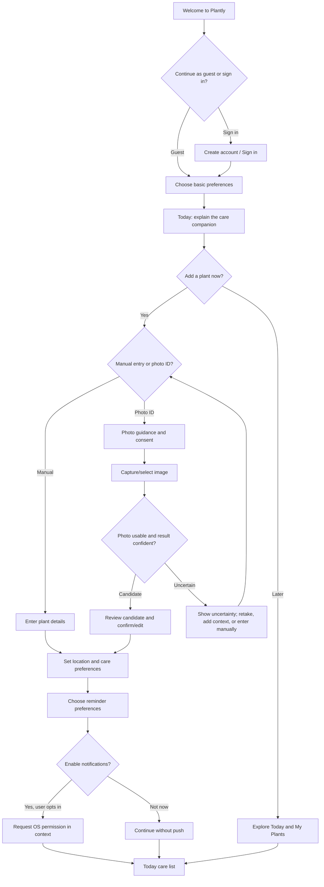
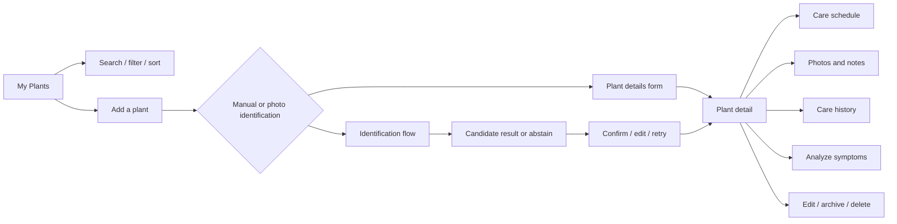

# Plantly App Flow

**Status:** Draft  
**Platforms:** iOS and Android  
**Visual direction:** Balanced Tend-inspired workflow, Plantly identity, light and dark themes

## 1. Navigation model

Primary navigation uses four destinations:

- **Today:** current care check-ins and next steps.
- **My Plants:** collection and plant detail.
- **Discover:** identify a plant or understand symptoms.
- **Profile:** preferences, notifications, subscription, privacy and support.

Use a persistent bottom navigation bar on primary screens. Keep add-plant and add-task actions visible within the relevant context. Do not require AI use to complete onboarding or add a plant.

## 2. First-run flow

## 3. Core daily loop

1. **Today:** show due and upcoming tasks grouped by urgency and plant. Provide concise action labels such as “Check soil,” “Rotate,” or “Inspect leaves.”
2. **Task detail:** explain why the check is suggested, the plant it concerns and the schedule source. Offer complete, snooze, skip and edit schedule.
3. **Completion:** record the action, optionally add a note, and calculate the next due date using the user’s local calendar/time zone.
4. **Return:** Today updates immediately; plant detail shows recent care history.

Empty state: invite the user to add their first plant. Avoid showing fake urgent tasks or pressuring the user to subscribe.

## 4. Plant collection and detail

Plant detail sections: name and identification status; current care check-ins; editable care schedule; photos/notes; care history; symptom assessments. Confirmed and AI-suggested names must be visually distinguishable.

## 5. Identification flow

1. Explain that image processing is used to suggest a plant identity; offer manual entry.
2. Give short photo tips and request camera/photo library permission only when the user selects that source.
3. Review image, crop/retake and submit.
4. Show progress without implying a guaranteed answer.
5. Result states:
   - **Likely candidate:** show name, concise basis and confirm/edit actions.
   - **Several candidates:** show a short ranked list and ask the user to select or retry.
   - **Uncertain/poor image:** explain what is missing and offer retake, another view or manual entry.
   - **Unsupported/no plant/provider unavailable:** explain and preserve a manual path.
6. After confirmation, user reviews plant profile and care preferences before saving.

## 6. Symptom-analysis flow

1. Entry points: Discover or a plant’s detail page.
2. Select an existing plant or continue without one; capture a close-up and optionally a whole-plant image.
3. Ask only relevant context questions, such as recent watering, light change and how widely symptoms appear.
4. Return visible observations separately from possible causes, with qualitative confidence and safe next steps.
5. If evidence is weak, ask for more information or state that the image is inconclusive.
6. User may save the assessment to the plant, retry, add a note or exit. No treatment is applied automatically.

## 7. Care schedule flow

From plant detail or a task: review task type and suggested interval range → choose/edit recurrence and preferred local time → enable/disable reminders → save. Explain that suggested schedules are starting points and environmental conditions matter. Completion changes the task record; schedule editing affects future task generation.

## 8. Freemium and paywall flow

Show paywall only after a relevant limit is reached or the user opens an upgrade action. Explain the current free allowance, paid benefit, price and renewal period using store-localized terms. Provide continue/close, purchase, restore and manage-subscription paths. On purchase, wait for verified entitlement refresh before unlocking. On cancellation or billing change, keep user data accessible and explain the effective access date.

## 9. Profile, settings and account lifecycle

Profile contains:

- Account and sign-in methods.
- Locale, time zone, units and theme (system/light/dark).
- Notification categories, quiet hours and permission status.
- Subscription status, restore and store management link.
- AI/image processing information and analytics preferences.
- Export data, delete account, help and privacy policy.

Deletion requires clear confirmation and re-authentication where appropriate. Confirm what will be removed and any disclosed backup retention window.

## 10. Permissions and error states

| Capability | Ask when | If denied/unavailable |
|---|---|---|
| Camera | User chooses to take a photo | Offer photo library and manual entry. |
| Photo library | User chooses an existing photo | Offer camera and manual entry. |
| Notifications | User enables reminders after seeing their value | Keep care list in app; provide settings shortcut without repeatedly prompting. |
| Network/AI | User submits an image | Preserve local draft where feasible; retry later or continue manually. |

Every network workflow needs loading, empty, retryable failure, offline and success states. Do not show raw provider or database errors to the user.

## 11. Cross-cutting behavior

- Persist unsent user edits safely and distinguish synced from pending changes.
- Do not duplicate tasks or notifications after retries.
- Recalculate future local reminder times when the user changes timezone or preferred reminder time.
- Use generic lock-screen copy, with optional user-controlled detail.
- Support large text, screen readers, keyboard navigation where relevant and contrast in both themes.
