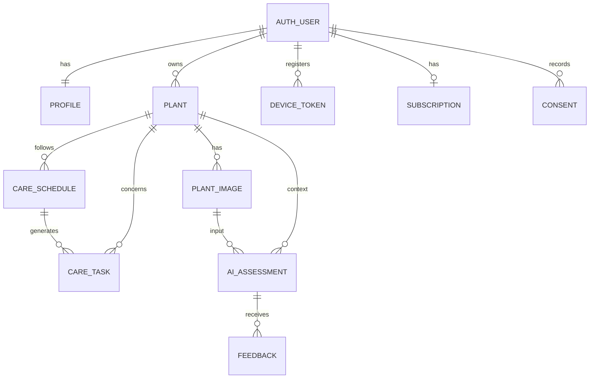

# Plantly Background Schema

**Status:** Draft technical reference  
**Interpretation:** “Background schema” is treated here as the backend data model and storage/security structure.  
**Database:** PostgreSQL (recommended through Supabase)

## 1. Modeling principles

- PostgreSQL is the source of truth for user, plant, schedule, task and entitlement snapshots.
- Every user-owned row carries `user_id`; database policies enforce ownership.
- Use UUID identifiers, `timestamptz` for absolute time and IANA timezone names for local schedule behavior.
- Keep AI candidates separate from user-confirmed plant facts.
- Keep image bytes in private object storage; store only metadata and opaque object paths in the database.
- Keep provider payloads compact and versioned; do not store prompts or images for training by default.
- Make task generation and webhook handling idempotent.

## 2. Entity relationship overview

## 3. Tables

### `profiles`

One row per authenticated user, keyed by the auth provider’s user ID.

| Column | Type | Notes |
|---|---|---|
| `user_id` | UUID PK/FK | References auth user; cascade on account deletion. |
| `display_name` | text nullable | User-provided display name. |
| `locale` | text | BCP 47 locale, e.g. `en-US`. |
| `timezone` | text | IANA zone, e.g. `America/Los_Angeles`. |
| `unit_system` | enum/text | `metric` or `imperial`. |
| `theme` | enum/text | `system`, `light`, `dark`. |
| `created_at`, `updated_at` | timestamptz | Audit timestamps. |

### `plants`

| Column | Type | Notes |
|---|---|---|
| `id` | UUID PK | Plant record ID. |
| `user_id` | UUID FK | Owner; indexed and RLS protected. |
| `name` | text | User-facing name. |
| `common_name` | text nullable | Candidate or confirmed common name. |
| `scientific_name` | text nullable | Candidate or confirmed scientific name. |
| `identification_status` | enum | `manual`, `suggested`, `confirmed`, `unknown`. |
| `location_label` | text nullable | User-entered room/location; no precise GPS. |
| `light_level` | enum/text nullable | User-editable coarse value. |
| `notes` | text nullable | Private user notes; never send to analytics. |
| `archived_at` | timestamptz nullable | Hidden from active collection. |
| `created_at`, `updated_at` | timestamptz | Audit timestamps. |

### `plant_images`

| Column | Type | Notes |
|---|---|---|
| `id` | UUID PK | Image metadata ID. |
| `user_id` | UUID FK | Owner. |
| `plant_id` | UUID FK nullable | Nullable for an in-progress identification. |
| `storage_path` | text unique | Opaque path in private bucket; never a public URL. |
| `purpose` | enum | `profile`, `identification`, `symptom`. |
| `mime_type` | text | Allowlisted image type. |
| `byte_size` | bigint | Enforce upload limit. |
| `captured_at` | timestamptz nullable | Optional; strip EXIF GPS regardless. |
| `retention_until` | timestamptz nullable | Supports transient-image deletion. |
| `deleted_at`, `created_at` | timestamptz | Lifecycle metadata. |

### `care_templates`

Curated baseline care suggestions, not user-owned. Template source and revision must be traceable.

| Column | Type | Notes |
|---|---|---|
| `id` | UUID PK | Template ID. |
| `species_key` | text nullable | Catalog key if sufficiently reliable. |
| `task_type` | enum/text | Water check, rotate, inspect, fertilize, etc. |
| `min_interval_days`, `max_interval_days` | integer nullable | Range rather than universal exact date. |
| `seasonal_rules` | JSONB nullable | Versioned, validated rule data. |
| `guidance_key` | text | Localizable copy key. |
| `source`, `version` | text | Provenance and revision. |
| `active` | boolean | Retire old guidance without deleting history. |

### `care_schedules`

| Column | Type | Notes |
|---|---|---|
| `id` | UUID PK | Schedule ID. |
| `user_id`, `plant_id` | UUID FK | Owner and plant; verify owner consistency. |
| `task_type` | enum/text | Care action. |
| `interval_days` | integer nullable | User-selected interval. |
| `next_due_at` | timestamptz nullable | Next occurrence. |
| `local_time` | time nullable | Preferred local reminder time. |
| `enabled` | boolean | Disable without losing history. |
| `source` | enum/text | `manual`, `template`, `ai_suggestion`. |
| `created_at`, `updated_at` | timestamptz | Audit timestamps. |

### `care_tasks`

| Column | Type | Notes |
|---|---|---|
| `id` | UUID PK | Task occurrence. |
| `user_id`, `plant_id` | UUID FK | Owner and plant. |
| `schedule_id` | UUID FK nullable | Originating schedule. |
| `task_type` | enum/text | Snapshot of action type. |
| `due_at` | timestamptz | Absolute due instant. |
| `status` | enum | `due`, `completed`, `snoozed`, `skipped`, `cancelled`. |
| `completed_at`, `snoozed_until` | timestamptz nullable | State details. |
| `idempotency_key` | text unique per user | Prevent duplicate generated occurrences. |
| `created_at`, `updated_at` | timestamptz | Audit timestamps. |

### `ai_assessments`

| Column | Type | Notes |
|---|---|---|
| `id` | UUID PK | Assessment ID. |
| `user_id` | UUID FK | Owner. |
| `plant_id` | UUID FK nullable | Associated plant, if any. |
| `image_id` | UUID FK | Input image metadata. |
| `kind` | enum | `identification`, `symptom_analysis`. |
| `status` | enum | `identified`, `candidate_list`, `needs_more_information`, `unsupported`, `provider_unavailable`. |
| `provider`, `model_version` | text | Operational provenance. |
| `result` | JSONB | Versioned result contract; validated before persistence. |
| `confidence_tier` | enum nullable | `low`, `medium`, `high`; do not treat as calibrated probability. |
| `created_at`, `expires_at` | timestamptz | Retention controls. |

### Supporting tables

| Table | Important fields | Purpose |
|---|---|---|
| `device_tokens` | `id`, `user_id`, `platform`, `push_token`, `locale`, `timezone`, `enabled`, `last_seen_at` | Per-device push registration; remove on sign-out/deletion. |
| `subscriptions` | `user_id` PK, `entitlement`, `store`, `status`, `period_end`, `provider_customer_id`, `updated_at` | Normalized verified entitlement snapshot; no card data. |
| `billing_events` | `provider_event_id` unique, `event_type`, `received_at`, `processed_at`, `status` | Webhook dedupe and retry ledger; restrict access. |
| `consents` | `id`, `user_id`, `purpose`, `policy_version`, `granted_at`, `revoked_at` | Record optional consent state and policy revision. |
| `feedback` | `id`, `user_id`, `assessment_id`, `rating`, `correction`, `created_at` | AI quality feedback; minimize free-text collection. |

## 4. Relationships, indexes and constraints

- Enforce that every `plant_id` referenced with a `user_id` belongs to the same user. Use composite unique keys or database constraints where useful.
- Index `plants(user_id, archived_at)`, `care_tasks(user_id, due_at, status)`, `ai_assessments(user_id, plant_id, created_at DESC)`, and `plant_images(user_id, plant_id)`.
- Enforce unique `(user_id, idempotency_key)` for task instances and unique provider event IDs for billing webhooks.
- Use check constraints for positive intervals, allowed status values, and nonnegative image sizes.
- Use transaction boundaries for task state updates plus recurrence generation.
- Use cascade deletion for user-owned records when appropriate; retain only minimal legally required billing metadata with documented policy.

## 5. Access control and storage

- Enable RLS on every user-owned table. Policies use the authenticated subject ID and allow only owner-scoped select/insert/update/delete.
- Prevent clients from changing `user_id`, provider IDs, subscription status or server-managed assessment fields.
- Keep storage buckets private. Object policies must validate that the storage path maps to a row owned by the authenticated user.
- Use short-lived signed URLs; do not log them or return them to analytics.
- Server functions use narrowly scoped service credentials only for operations that cannot be safely performed under user JWT/RLS.
- Test direct table access, guessed UUIDs, cross-user plant/image IDs, stale signed URLs and account deletion.

## 6. API and event boundaries

Direct RLS-protected CRUD is suitable for plant/profile/schedule/task reads and user-edited fields. Use server functions for `authorize upload`, `identify`, `analyze symptoms`, subscription webhooks, push dispatch, export and deletion. All privileged operations need authenticated requests or provider authentication, input validation, request IDs, rate limits and idempotency where retries are possible.

## 7. Retention and deletion

- Plant profile photos persist until the user deletes them or the account is removed.
- Temporary analysis images receive a defined expiration and deletion job; do not retain for model training by default.
- Assessments follow a documented user-facing retention policy and can be deleted with the associated plant/account.
- Remove device tokens at sign-out/account deletion and disable invalid tokens after delivery errors.
- Account deletion is retryable and observable. It removes user rows, storage objects and identity links, with clear disclosure of backup expiry and any store-controlled billing history that Plantly cannot delete.

## 8. Open schema decisions

- Final image retention windows and whether assessment history is a paid feature.
- Whether guest plants are local-only or can be migrated to an account.
- Whether future sharing requires household/team ownership tables; avoid speculative schema until product scope is approved.
- Exact curated species/care template source, taxonomy model and review process.
- Whether analytics events are stored only in a dedicated provider or a minimal first-party event table.
